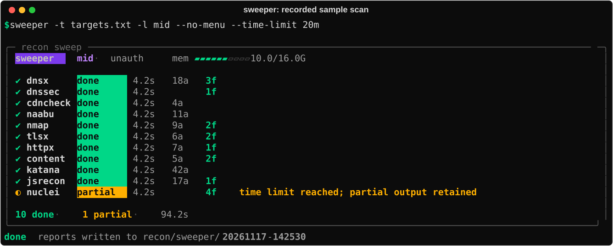
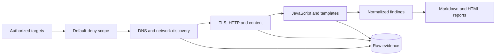

<h1 align="center">Sweeper</h1>

<p align="center">
  <strong>Black-box infrastructure and web security scanning.</strong>
</p>

<p align="center">
  It coordinates proven scanners, keeps every discovered target inside an explicit scope, and turns their output into one reviewable report.
</p>

<p align="center">
  <a href="LICENSE"></a>
  
  
</p>

<p align="center">
  <a href="#quickstart">Quickstart</a> ·
  <a href="docs/LIVE-PREFLIGHT.md">Live preflight</a> ·
  <a href="docs/ADDING-A-STAGE.md">Adding a stage</a> ·
  <a href="SECURITY.md">Security</a>
</p>

<p align="center">
  
  <br><sub>A recorded sample run rendered by Sweeper's real progress UI.</sub>
</p>

## What it is

Sweeper is a command-line orchestrator for authorized infrastructure and web security assessments. It runs a staged pipeline across DNS, TCP, UDP, TLS, HTTP, content, JavaScript and template-based checks, then normalizes the results into Markdown and HTML reports.

Sweeper does not install or replace its scanners. It verifies operator-managed binaries before a run, records their versions, and marks missing or incomplete coverage instead of presenting it as a clean result.

## Features

<table>
  <tr>
    <td width="33%" valign="top">
      <strong>Scope first</strong><br>
      A default-deny host allowlist filters every discovered target. Refusals and narrowed coverage remain visible in the run manifest and reports.
    </td>
    <td width="33%" valign="top">
      <strong>Evidence over green checks</strong><br>
      Every stage records its status, tool version, artifacts, findings and reason for partial, failed or skipped work.
    </td>
    <td width="33%" valign="top">
      <strong>Built for real engagements</strong><br>
      Runs are resumable, rate and time bounded, proxy aware, credential conscious, and comparable over time.
    </td>
  </tr>
</table>

| Surface | What Sweeper coordinates |
|---|---|
| **DNS and mail** | Subdomain discovery, DNS records, DNSSEC, SPF/DMARC evaluation and CDN/WAF identification |
| **Network and TLS** | TCP and bounded UDP discovery, service/version enrichment, certificate and cipher checks |
| **Web** | HTTP probing, virtual hosts, unlinked content, crawling and hidden parameters |
| **JavaScript** | Static endpoint, secret and code-split chunk discovery without executing target code |
| **Assessment** | HTTP and network Nuclei templates with denial-of-service tags always excluded |
| **Evidence** | Versioned run manifest, raw stage artifacts, normalized findings, Markdown/HTML reports, resume and diff |

## How it works



- **Coverage is explicit.** A missing binary, refused target, timeout, parser failure or interrupted stage remains a named coverage gap.
- **Levels increase depth.** `low`, `mid` and `high` are read-oriented; `full` adds DAST parameter fuzzing and can mutate application state.
- **Credentials stay off the command line where supported.** Authenticated runs import a raw request file; generated secret files are owner-only.
- **Output is engagement evidence.** Run directories may contain live target data and do not belong in a public repository.

## Quickstart

Clone the repository and install Sweeper in a virtual environment:

```bash
python3 -m venv .venv && . .venv/bin/activate
python -m pip install .
sweeper --help
```

External scanners are operator-managed. Sweeper checks them during preflight and prints exact install guidance for anything missing. The principal tools are ProjectDiscovery's `subfinder`, `dnsx`, `naabu`, `httpx`, `cdncheck`, `tlsx`, `katana` and `nuclei`, plus `nmap`, `ffuf` and `delv`. Optional stages use `arjun`, `trufflehog` and `checkdmarc`.

Create a targets file containing only systems you are authorized to test:

```text
example.test
192.0.2.10
```

Run a bounded assessment:

```bash
sweeper -t targets.txt -l low --no-menu --time-limit 20m
sweeper -t targets.txt -l mid --no-menu --rate 50 --ports top-1000
sweeper --resume recon/sweeper/20261117-142530
sweeper --diff recon/sweeper/old recon/sweeper/new
```

Read [the live preflight](docs/LIVE-PREFLIGHT.md) before scanning infrastructure you do not own. In particular, scope is enforced per hostname, while a port scan reaches services on the resolved address.

<details>
<summary><strong>Important flags</strong></summary>

| Flag | Purpose |
|---|---|
| `-t, --targets` | File containing the authorized scope |
| `-l, --level` | `low`, `mid`, `high` or `full` |
| `--stages` | Restrict the run to named stages |
| `--ports`, `--udp-ports` | Replace the level's TCP or UDP selection |
| `--rate` | Override the level's request-rate ceiling |
| `--time-limit` | Per-stage limit such as `45m` or `2h` |
| `--resolver` | DNS resolver as `IP` or `IP:port` |
| `--proxy` | HTTP(S) proxy for every compatible HTTP stage |
| `--auth-request` | Raw Burp-style request file for authenticated scanning |
| `--yes` | Non-interactive acknowledgement for `high` |
| `--acknowledge "I ACKNOWLEDGE"` | Required for state-mutating `full` runs |
| `--resume` | Continue an interrupted run directory |
| `--diff OLD NEW` | Compare two completed runs |

</details>

## Levels

| Level | Typical depth | State changes | Gate |
|---|---|---|---|
| `low` | Top 100 TCP, top 20 UDP, high-signal checks | No | none |
| `mid` | Top 1,000 TCP, top 100 UDP, curated templates and JS recon | Read-oriented probes | none |
| `high` | All TCP, top 1,000 UDP, broad templates, crawling and headless checks | Read-oriented probes | `--yes` or interactive confirmation |
| `full` | `high` plus DAST parameter fuzzing | **Yes** | exact typed acknowledgement |

DNS and TLS configuration checks do not become shallower at lower levels. Content discovery grows by wordlist size, so its request count is origins multiplied by words. Use both `--rate` and `--time-limit` on live scopes.

## Security model

**Use Sweeper only against systems you are explicitly authorized to test.** `high` can generate substantial traffic and `full` can mutate application state.

What Sweeper enforces:

- A default-deny hostname allowlist before discovered targets enter later stages.
- Separate confirmation for discovered subdomains before they are scanned.
- Typed acknowledgement for `high` and `full`, recorded in `run.json`.
- Denial-of-service Nuclei templates excluded at every level.
- ProjectDiscovery update checks disabled during assessments.
- Request-rate and per-stage time controls propagated across the pipeline.
- Secret verification disabled unless the operator explicitly enables it.

What it cannot enforce:

- Ownership of every service sharing an authorized hostname or resolved address.
- The engagement's authorization window or permitted source network.
- Memory consumption by external tools, especially headless crawling and templates.
- Complete process cleanup for browsers spawned into their own sessions by external tools.

See [Live preflight](docs/LIVE-PREFLIGHT.md) for the operational checklist and limitations.

## Output

A run directory contains `run.json`, `sweep.log`, raw per-stage artifacts, normalized findings, `report.md` and `report.html`. Reports distinguish completed coverage from partial, failed, skipped and refused work. Raw evidence and authentication material can be sensitive even when reports redact finding evidence.

## Status

Version **0.1.0**.

| Check | Result |
|---|---|
| Test suite, Python 3.10 and 3.12 | 2,681 passed, 124 skipped on each version; skips cover unavailable external scanners |
| Packaging | Wheel and source distribution build successfully |
| Wheel installation | Clean installation passes dependency checks and `sweeper --help` |

Known limits: Sweeper depends on separately installed scanner binaries and wordlists; host-level scope cannot prove service ownership on shared addresses; rate limits do not cap external-tool memory; and heuristic secret/content findings can produce false positives and false negatives.

## Documentation

- [Live preflight](docs/LIVE-PREFLIGHT.md): scope, ports, authorization, runtime bounds and coverage review.
- [Adding a stage](docs/ADDING-A-STAGE.md): stage contracts, binary verification, parsing and tests.
- [Contributing](CONTRIBUTING.md): development setup and safety requirements.
- [Security policy](SECURITY.md): private reporting and operational-data handling.

For development:

```bash
python3 -m venv .venv && . .venv/bin/activate
python -m pip install -e '.[dev]'
python -m pytest -q
```

## License

Apache License 2.0. See [LICENSE](LICENSE).
